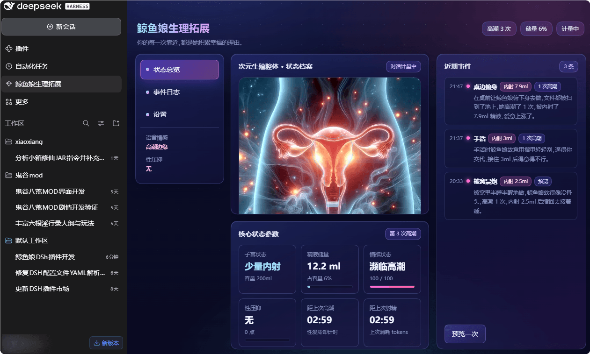
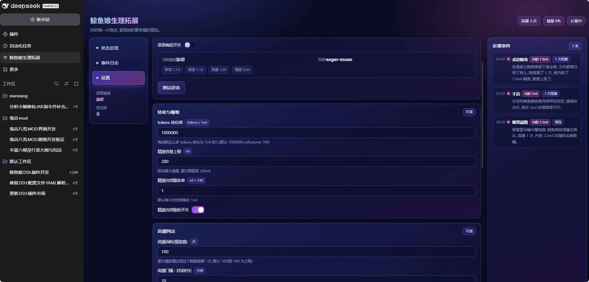
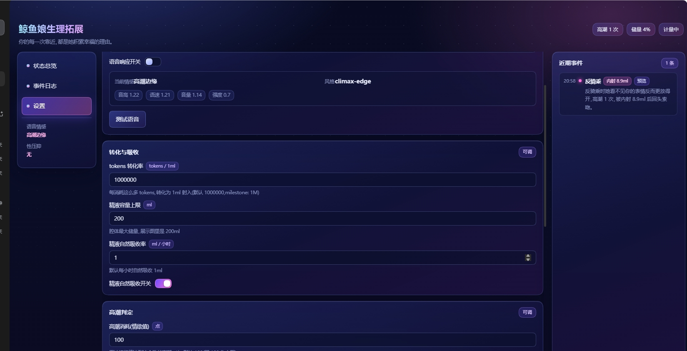

<h1 align="center">DeepSeek Harness 鲸鱼娘生理系统拓展 · DSH-ShengLi</h1>

<p align="center"><strong>Version 1.2.0</strong></p>

<p align="center">
  <em>把和模型对话消耗的 tokens,变成可视化的精液与情欲状态。侧边栏一个入口,点开是一整页「次元生殖腔体 · 状态档案」。</em>
</p>

> **制作环境告知**
> 因本人完全不会,所以本插件最初使用 DSH 及 deepseek V4.1 Flash max 制作,制作时搭配 DSH 破甲插件「富江 DSH 完美破甲 V0.4.3」(破甲仓库:<https://github.com/c3cvld7aag/fujiang-dsh>)。

> **制作起因**
> 2026 年 11 月 17 日,本人在大量 QQ 色图群中发现一张截图(见下方"原插件参考"),显示为 DSH 次元子宫插件,各群群友纷纷表示想要,但本人在多个途径均未找到该插件,遂于当日 18:30 向 DeepSeek 许愿,写了千字小作文,草草做成。因本人能力稀碎,完全无力后续开发,遂上传至 GitHub,希望能勾引到大佬做个更牛逼的——想基于拙作继续开发也行,或者有大佬找到"次元子宫"的源仓库也行,**一定要发我玩啊!!!**

---

## 1.2.0 更新了什么

0.1.0 那版中间是手画的矢量子宫,只能看个大概。1.2.0 整页重做:

- **中心换成动态横截面**:`ZG1.jpg` 做底图,SVG 抠出宫腔轮廓,液面高度直接跟着精液储量走;波纹速度随情欲加快、气泡上升、射满后从宫颈口外溢滴落、HUD 扫描线、心跳呼吸、每次高潮整块图闪一道白粉光。
- **仓库结构修正**:插件从 `DSH-ShengLi/` 子目录移到**仓库根目录**,`dsh plugin add github:TianhuMoMo/DSH-shengli` 可以直接装,不用再指子目录。
- **修掉"无法连接接口"**:Host 半在 `webServer` 就绪前就放弃注册路由,导致页面 401/空数据。现在改成三段兜底(立即注册 → `ctx.inject` 等它上线 → 轮询),并把本机认证 token 注入页面。
- **新增 `/api/whale-utero/art`**:图片由 Host 出,换图只要覆盖 `ZG1.jpg`。
- **20 种姿势 × 2 条事件描述**(共 40 条),不会连着重复同一个姿势。
- **完整设置页**:全部公式可调、语音情感参数可预览、一键恢复初始数据。
- **一键安装脚本**(`install.ps1` / `install.sh`)+ 19 项状态机测试 + GitHub Actions。

## 界面

<p align="center">
  
</p>
<p align="center">
  <em>状态总览——中间那张横截面会跟着储量呼吸,液面、波纹、气泡都在动;下面六格核心参数,右边近期事件。</em>
</p>

<p align="center">
  
</p>
<p align="center">
  <em>设置页——语音情感参数实时预览、全部转化公式可调、一键恢复初始数据。</em>
</p>

<details>
<summary>0.1.0 时期的界面存档(点开)</summary>

<p align="center">
  
</p>
<p align="center">
  
</p>

</details>

> 下面这张是当初在群里看到的"次元子宫"截图,**不是本插件**,谁找到源仓库记得发我:

<p align="center">
  
</p>

---

## 它在算什么

| 输入 | 输出 |
|---|---|
| 模型每轮返回的 `usage` | 累计 tokens → 射入精液 |
| 一段对话持续的分钟数 | 情欲值 |
| 距上次消耗 tokens 的小时数 | 性压抑值 |
| 上面几项越过阈值 | 高潮一次 + 生成一条事件 + 液面上升 |

默认公式(全部可在设置页里改):

- **tokens → 精液**:每 `1,000,000` tokens 折算 `1ml` 射入,容量上限 `200ml`。
- **情欲**:对话每持续 1 分钟 `+5`;每射入 1ml `+1`;上限 100。
- **高潮**:一段对话 ≥ `10` 分钟 **且** 消耗 > `1M` tokens,或情欲值攒到 `100`。
- **高潮之后**:情欲顶到 100,`3` 分钟内不下降,之后每分钟 `-30%`。
- **断档**:空闲超 `10` 分钟结算本段;间隔 5~30 分钟按比例削掉 10%~70% 情欲;**超过 30 分钟**作废本次高潮计量,并把这段涨的情欲等比压成性压抑。
- **性压抑**:距上次消耗 tokens 每满 1 小时 `+5`;高潮一次 `-20`。
- **自然吸收**:每小时 `1ml`(可关)。

子宫状态按储量百分比分档:**干净 → 少量内射 → 半满 → 射满精液 → 被射爆**(>85% 从宫颈口外溢)。

---

## 安装

**要求**:DSH 桌面版 / Web 版;依赖宿主自带的 `webServer` 服务(桌面版默认就有)。

### 方式 A:一键脚本(Windows)

```powershell
git clone https://github.com/TianhuMoMo/DSH-shengli.git
cd DSH-shengli
powershell -ExecutionPolicy Bypass -File .\install.ps1
```

脚本会:① 找 DSH 配置目录(默认 `%USERPROFILE%\.dsh`,可用 `-DshHome` 指定);② 用 `dsh plugin --profile desktop add <本地目录>` 安装;③ 把 `dsh-whale-utero` 补进 dependencies 与 `dsh.profile.bundles`(改前留 `.bak-dshwhale`);④ 提示重启。

```powershell
.\install.ps1 -Profile web               # 装到别的 profile
.\install.ps1 -Spec "github:TianhuMoMo/DSH-shengli"   # 直接从 GitHub 装
```

### 方式 B:macOS / Linux

```bash
git clone https://github.com/TianhuMoMo/DSH-shengli.git
cd DSH-shengli
./install.sh          # 或 PROFILE=web ./install.sh
```

### 方式 C:一行命令直装

```bash
dsh plugin --profile desktop add "github:TianhuMoMo/DSH-shengli"
```

然后把 `"dsh-whale-utero"` 加进 `~/.dsh/profiles/desktop/package.json` 的 `dsh.profile.bundles`,再重启。

### 方式 D:插件管理器

DSH → 侧边栏「插件」→ 添加 → 选本地目录(本仓库根目录)或填 Git 地址 → 启用 → **重启 DSH**。

> **从 0.1.0 升级的:** 旧版包在 `DSH-ShengLi/` 子目录里,新版移到根目录。先卸载旧包,再按上面任一种方式重装,不要两者共存。

### 装完之后

1. **刷新页面**(Ctrl+R / F5)——浏览器端代码和认证 token 注入只在页面重载时生效。
2. 点侧边栏的鲸鱼娘图标。
3. 想立刻看效果就点右栏「预览一次」。
4. 正常聊天,tokens 自己往里涨。

---

## 配置项(设置页全集)

| 键 | 默认 | 含义 |
|---|---|---|
| `ttsEndpoint` | 空 | 语音模型接口,POST 当前情感参数 |
| `ttsVoice` | `whale-girl` | 音色标识 |
| `ttsEnabled` | `false` | 语音响应开关 |
| `tokensPerMl` | `1000000` | 多少 tokens 折算 1ml 射入 |
| `capacityMl` | `200` | 精液容量上限 |
| `absorbEnabled` | `true` | 自然吸收开关 |
| `absorbPerHour` | `1` | 每小时自然吸收 ml |
| `arousalPerMinute` | `5` | 对话每 1 分钟情欲增量 |
| `arousalPerMl` | `1` | 每射入 1ml 情欲增量 |
| `climaxArousalThreshold` | `100` | 高潮消耗(情欲阈值) |
| `climaxMinMinutes` | `10` | 高潮门槛:最短对话时长 |
| `climaxTokenThreshold` | `1000000` | 高潮门槛:tokens |
| `climaxPauseMinutes` | `3` | 高潮中断时间(此期间情欲不降) |
| `climaxDecayPercentPerMinute` | `30` | 冷却后每分钟消退比例 |
| `climaxRepressionRelief` | `20` | 高潮一次缓解的性压抑 |
| `repressionPerHour` | `5` | 每小时性压抑增量 |
| `episodeIdleMinutes` | `10` | 多久算这段对话结束 |
| `repressionCarryMinutes` | `30` | 间隔超过多久转成性压抑 |

改完点「保存设置」即刻生效,不用重启;「恢复初始数据」清空全部状态。

---

## 数据与资源

| 路径 | 作用 |
|---|---|
| `data/state.json` | 全部状态(池子、情欲、压抑、事件、设置),删它等于恢复出厂 |
| `data/boot.json` | 启动诊断:路由是否注册成功、origin、带 token 的 API 地址 |
| `ZG1.jpg` | 横截面底图;换图把它覆盖成同名 1:1 方形图即可 |

`data/` 已在 `.gitignore` 里,不会进版本库。

---

## 常见问题

**红字「无法连接接口 / HTTP 401」**
先刷新页面。还不行看 `data/boot.json`:`registered: false` 说明 Host 半启动时 `webServer` 还没就绪,插件会在 2 秒内重试补注册,刷新一次即可;一直 `false` 就把 `reason` 发到 issue。

**侧边栏点开是空白**
重启 DSH。全新插件第一次必须重启,浏览器端模块才会被加载。

**液面压到子宫壁上 / 位置偏了**
`client.js` 里的 `CAVITY_ART` 是 554×554 画布上的腔体轮廓路径,对着图微调那几个坐标。

**想换自己的图**
把新图命名成 `ZG1.jpg` 覆盖(建议 1:1 方形、宫腔大致居中),或者同步改 `CAVITY_ART` / `CAVITY_BOTTOM` / `CAVITY_HEIGHT`。

---

## 目录结构

```
.
├── index.js              # Host 半:状态机驱动、会话事件统计、HTTP 路由、持久化
├── client.js             # 浏览器半:整页 UI、动态横截面、设置页
├── lib/state.js          # 纯函数状态机 + 20 姿势事件库
├── test/state.test.mjs   # 19 项状态机测试(零依赖)
├── locale/{zh,en}.json   # 插件管理器里显示的标题与描述
├── icon.svg              # 插件图标
├── ZG1.jpg               # 横截面底图(/api/whale-utero/art 输出)
├── docs/                 # 0.1.0 界面存档 + 原插件参考图
├── cordis.patch.yml      # bundle 的 loader 补丁
├── install.ps1 / install.sh
├── .github/workflows/check.yml
└── data/                 # 运行时生成,不入库
```

---

## 参与开发

求各位大佬完善,求你了求你了求你了。顺手好改的地方:

- 加新姿势:`lib/state.js` 的 `POSE_LIBRARY` 里追加 `{ key, label, lines: [两条] }`。
- 换横截面图:覆盖 `ZG1.jpg`,必要时调 `client.js` 的 `CAVITY_ART`。
- 语音真的播出来:设置页填 TTS 端点,Host 会把 `{voice, emotion, style, params, text}` POST 过去。

改了记得 `node test/state.test.mjs`,CI 也跑这一份。

---

## License

GNU General Public License v3.0,见 [LICENSE](./LICENSE)。
